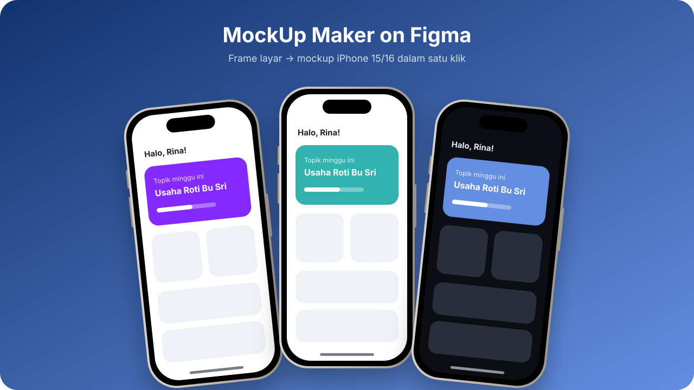
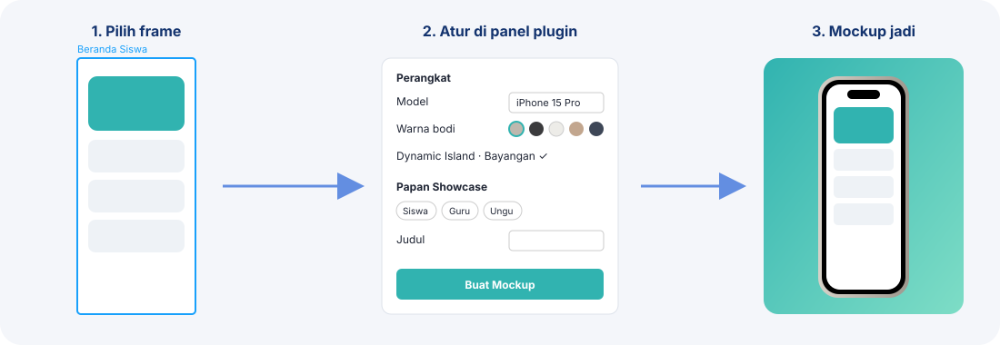

<div align="center">

# 📱 MockUp Maker on Figma

**Ubah frame layar menjadi mockup iPhone 15 / 16 high-fidelity dalam satu klik, langsung di Figma.**



</div>

---

## ✨ Fitur

| | |
|---|---|
| 📐 **6 model iPhone** | iPhone 15, 15 Pro, 15 Pro Max, 16, 16 Pro, 16 Pro Max |
| 🎨 **6 warna bodi** | Natural, Black, White, Desert, Blue Titanium, Midnight |
| 🏝️ **Detail perangkat** | Bezel, Dynamic Island, tombol samping (+ Camera Control di seri 16) |
| 🌗 **Efek** | Bayangan lembut, kilap layar, rotasi |
| 🖼️ **Papan showcase** | Latar solid/gradien, preset warna, judul & subjudul, banyak HP berjajar |
| 📏 **Skala otomatis** | Ukuran mockup mengikuti lebar frame (393 px, 786 px, dst.) |
| 📜 **Long screen** | Opsi tinggi layar ikut tinggi frame untuk halaman scroll |
| 🔒 **Frame asli aman** | Plugin membuat salinan; component dipakai sebagai *instance* agar ikut ter-update |

## 🚀 Cara Kerja



## 📦 Instalasi

> Plugin lokal hanya bisa diimpor dari **Figma Desktop** (Windows/macOS), bukan dari browser.

1. **Unduh** repo ini → tombol hijau **Code → Download ZIP**, lalu ekstrak. Atau:
   ```bash
   git clone https://github.com/Naufal-Ghani22/MockUp-Maker-on-Figma.git
   ```
2. Buka **Figma Desktop** dan buka file desain apa saja.
3. Menu **Plugins → Development → Import plugin from manifest…**
4. Pilih file **`manifest.json`** di folder hasil unduhan.
5. Selesai. Plugin muncul di **Plugins → Development → Mockup HP iPhone**.

> ⚠️ Jangan pindah/hapus folder setelah diimpor. Figma membaca plugin dari lokasi itu. Kalau dipindah, impor ulang `manifest.json`.

## 🛠️ Cara Memakai

1. **Pilih frame** layar di kanvas. Bisa satu atau banyak (tahan `Shift`). Urutan HP mengikuti posisi frame dari kiri ke kanan.
2. **Jalankan plugin** → *Plugins → Development → Mockup HP iPhone*.
3. **Atur perangkat**
   - **Model**: pilih iPhone 15/16 sesuai kebutuhan.
   - **Warna bodi**: klik salah satu bulatan warna.
   - Centang **Dynamic Island**, **Bayangan**, **Kilap layar** sesuai selera.
   - **Rotasi** untuk HP miring (mis. `-8`), **Jarak antar HP** dalam px.
4. **Atur papan showcase** *(opsional)*
   - Klik preset **Siswa / Guru / Ungu / Terang / Gelap**, atau pilih warna sendiri.
   - Isi **Judul** dan **Subjudul**. Centang **Teks gelap** untuk latar terang.
5. Klik **Buat Mockup dari Frame Terpilih**. Hasil muncul di sebelah kanan frame asli.

### 💡 Tips

- Desain dibuat sebagai **Component**? Centang **Pakai instance**, maka mockup otomatis ikut berubah saat desain diedit.
- Untuk ekspor laporan/slide: pilih papan showcase → **Export** PNG `2x`.
- Layar panjang (scroll)? Centang **Tinggi layar ikut frame**.
- Isi layar masih bisa diedit: masuk ke layer `Layar` di dalam mockup.

## 📁 Struktur

```
├── manifest.json   # konfigurasi plugin
├── code.js         # logika pembuatan mockup
├── ui.html         # panel pengaturan
└── docs/           # gambar README
```

## 🧩 Struktur Layer Hasil

```
iPhone 15 Pro — Nama Frame
├── Tombol ×4–5
├── Bodi            (gradien titanium + bayangan)
├── Bezel
├── Layar           (clip, radius sudut layar)
│   └── salinan frame / instance
├── Dynamic Island
└── Kilap           (opsional)
```

---

<div align="center">
Dibuat oleh <b>Naufal Ghani</b> · untuk tim NOVA, GEMASTIK XIX 2026
</div>
